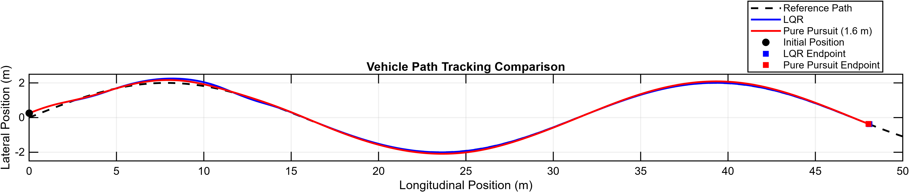
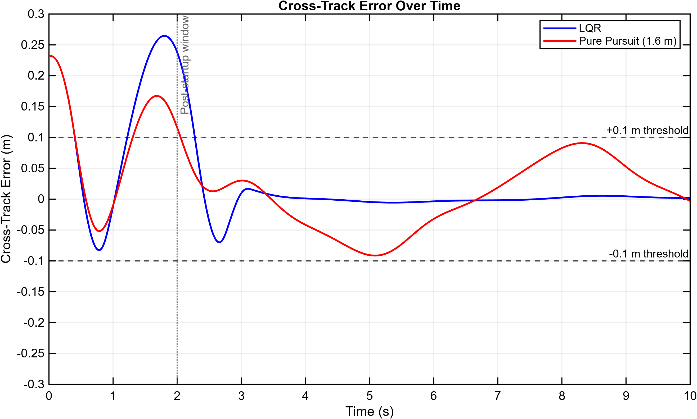
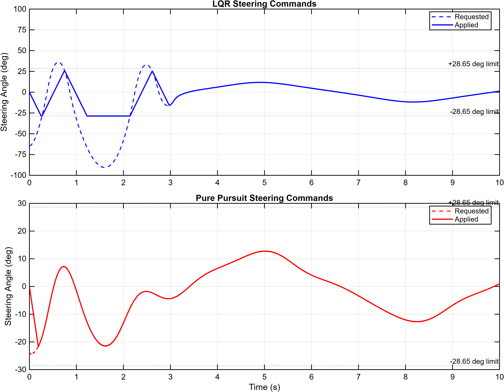

# Vehicle Dynamics and Controls Simulation

A simulation and software implementation project exploring vehicle dynamics, path tracking, state estimation, and feedback control using C++, MATLAB, and Python.

The repository contains two related stages of work:

1. An original C++ vehicle simulation combining a dynamic bicycle model and Pure Pursuit path tracking with an Extended Kalman Filter (EKF) that estimates vehicle state from noisy simulated GPS and IMU measurements.
2. A more detailed MATLAB controls study using nonlinear Fiala tire forces to compare LQR and Pure Pursuit, followed by a C++17 implementation of the LQR controller and steering actuator with automated tests.

The stages use different vehicle and estimation models. They are presented separately below rather than as one continuously integrated simulator.

## Project Contents

| Area | What it contains |
|---|---|
| Original C++ simulation | Dynamic bicycle model, Pure Pursuit steering, GPS/IMU EKF, and logged trajectory data |
| MATLAB simulation | Nonlinear dynamic bicycle model, Fiala tire forces, LQR and Pure Pursuit comparison, operating-condition sweeps |
| C++ controller | C++17 LQR controller and steering actuator implementation, with CTest coverage and MATLAB numerical comparisons |
| Python analysis | EKF error metrics and plots from the original C++ simulation log |

## 1. Original C++ Vehicle Simulation

`main.cpp` simulates a vehicle following the reference path

$$
y(x) = 2\sin(x/5)
$$

using a dynamic bicycle model with linear lateral tire-force approximations.

### Vehicle model

The model represents longitudinal velocity, lateral velocity, yaw rate, global position, and heading. Longitudinal speed is held constant while lateral and yaw dynamics are integrated.

| Parameter | Value |
|---|---:|
| Vehicle mass | 200 kg |
| Yaw moment of inertia | 250 kg m² |
| Front axle distance from CG | 1.25 m |
| Rear axle distance from CG | 1.25 m |
| Front cornering stiffness | 5,000 N/rad |
| Rear cornering stiffness | 5,000 N/rad |
| Longitudinal speed | 5 m/s |
| Integration timestep | 0.01 s |
| Simulation duration | 10 s |

Front and rear lateral tire forces are calculated from tire slip angles and constant cornering stiffness values. This is a linear tire-force approximation; it is not the nonlinear Fiala model used in the later MATLAB simulation.

### Pure Pursuit path tracking

The original C++ controller selects a point ahead of the estimated vehicle position and calculates a steering command from the lookahead geometry. The configured lookahead distance is 2.0 m. The steering command is constrained by an approximately ±30-degree steering-angle limit and a 2.0 rad/s steering-rate limit.

The controller uses the EKF state estimate for target-point selection and heading-error calculation.

### GPS/IMU state estimation

The EKF estimates four states:

$$
\hat{\mathbf{x}} =
\begin{bmatrix}
x \\
y \\
\psi \\
v_x
\end{bmatrix}
$$

Its measurement vector contains GPS position and IMU heading:

$$
\mathbf{z} =
\begin{bmatrix}
x_{\mathrm{GPS}} \\
y_{\mathrm{GPS}} \\
\psi_{\mathrm{IMU}}
\end{bmatrix}
$$

The GPS and IMU measurements are simulated with sensor noise rather than taken directly from the true vehicle state. At each simulation timestep, zero-mean Gaussian noise is added to the ground-truth position and heading. The GPS position measurements have a standard deviation of 0.1 m per axis, while the IMU heading measurement has a standard deviation of 0.02 rad.

The measurement model is:

$$
\mathbf{z}_k =
\begin{bmatrix}
x_k \\
y_k \\
\psi_k
\end{bmatrix}
+
\mathbf{v}_k,
\qquad
\mathbf{v}_k \sim \mathcal{N}(\mathbf{0},R)
$$

where the measurement-noise covariance is:

$$
R =
\begin{bmatrix}
0.01 & 0 & 0 \\
0 & 0.01 & 0 \\
0 & 0 & 0.0004
\end{bmatrix}
$$

These noisy GPS and IMU measurements are used by the EKF correction step to update its estimates of vehicle position, heading, and longitudinal velocity.

There is no direct velocity measurement. The filter propagates its velocity estimate through its motion model and corrects the state using GPS position and IMU heading measurements. The covariance update uses the Joseph form.

An important modeling distinction is that the simulated vehicle's lateral and yaw response uses dynamic bicycle equations, while the EKF prediction uses a simplified kinematic bicycle motion model. The estimator is therefore not an exact copy of the simulated plant model.

### Logged data and Python analysis

The included `trajectory.csv` is a sample simulation log. It records true vehicle states, EKF estimates, simulated GPS and IMU measurements, steering commands, applied steering, tracking errors, and the EKF velocity correction. `reference.csv` contains the reference path.

- `analyze.py` calculates position, heading, and velocity estimation errors, including RMSE and maximum-error metrics, and compares raw sensor errors with EKF estimates.
- `plot.py` visualizes the reference and vehicle trajectories, lateral velocity, yaw rate, steering behavior, and EKF velocity estimation.

## 2. MATLAB Nonlinear Vehicle Simulation

The MATLAB simulator evaluates path tracking with a nonlinear dynamic bicycle model on the same reference path:

$$
y(x) = 2\sin(x/5)
$$

### Vehicle and tire model

| Parameter | Value |
|---|---:|
| Vehicle mass | 200 kg |
| Yaw moment of inertia | 250 kg m² |
| Front axle distance from CG | 1.25 m |
| Rear axle distance from CG | 1.25 m |
| Front cornering stiffness | 5,000 N/rad |
| Rear cornering stiffness | 5,000 N/rad |

The model calculates front and rear slip angles and nonlinear lateral forces using a Fiala tire-force model. It includes front tire-force projection into vehicle coordinates, lateral and yaw acceleration, and global vehicle position and heading integration.

The MATLAB model uses fixed longitudinal speed and static front/rear axle normal loads. Steering angle and steering-rate constraints are applied to the simulated actuator.

### Controllers

**Linear Quadratic Regulator (LQR)**

The LQR controller uses the tracking-error state

$$
\mathbf{x} =
\begin{bmatrix}
v_y-v_{y,\mathrm{ref}} \\
r-r_{\mathrm{ref}} \\
e_y \\
e_\psi
\end{bmatrix}
$$

and computes requested steering using

$$
\delta_{\mathrm{cmd}} = \delta_{\mathrm{ref}} - K\mathbf{x}
$$

The nominal controller is designed at 5 m/s with

$$
Q = \mathrm{diag}(1,1,70,15),
\qquad R=3
$$

**Pure Pursuit**

Pure Pursuit selects a target point ahead of the vehicle and calculates steering from target geometry and heading error. A 1.6 m lookahead distance was selected for the baseline comparison after a lookahead sweep.

Both MATLAB controllers use the same steering constraints:

- Maximum steering angle: ±0.5 rad.
- Maximum steering rate: 2.0 rad/s.

Requested and applied steering are logged separately to measure the effect of actuator constraints.

### Simulation assumptions and limitations

The MATLAB model uses fixed longitudinal speed, static axle normal loads, a simplified nonlinear lateral tire-force model, and discrete-time numerical integration. It does not include load transfer, longitudinal tire dynamics, combined tire slip, or detailed steering actuator dynamics. The parameters are generic simulation values and do not represent a production vehicle.

## 3. C++17 LQR Controller and Steering Actuator

The `cpp_controller/` directory contains a standalone C++17 implementation of the MATLAB-derived LQR steering calculation and steering actuator. It is not a complete C++ vehicle dynamics simulator.

```text
Tracking errors
      |
      v
 LQR controller
      |
      v
Requested steering
      |
      v
Steering actuator
      |
      v
 Applied steering
```

**LQR controller**

- Uses feedback gains calculated in MATLAB.
- Computes the requested front-wheel steering angle.
- Validates input values and the calculated output.
- Returns a failure status for invalid or non-finite values without modifying the output argument on failure.

**Steering actuator**

- Applies steering-angle saturation.
- Enforces steering-rate constraints.
- Validates timestep, inputs, and actuator configuration.
- Keeps actuator behavior separate from the controller calculation.

The controller and actuator interfaces use radians and SI units.

## 4. Verification and Testing

The C++ controller library uses CMake, Ninja, and CTest.

### MATLAB-to-C++ numerical verification

Three sampled MATLAB simulation states are used to verify that the C++ LQR implementation reproduces the MATLAB requested steering commands. The integrated controller and actuator are also compared against three MATLAB actuator transitions using a plant timestep of 0.0003125 s.

The sampled numerical comparisons use a tolerance of $10^{-12}$ radians. These checks establish agreement at selected reference operating points; they do not establish equivalence over every possible state or operating condition.

### Automated C++ test coverage

| Test suite | Individual checks |
|---|---:|
| LQR controller | 9 |
| Steering actuator | 11 |
| Integrated control pipeline | 3 |
| **Total** | **23** |

All three CTest suites pass after a clean build. These tests cover the standalone controller and actuator implementation, not the separate root-level `main.cpp` simulation.

## 5. MATLAB Results

The baseline comparison uses:

- Speed: 5 m/s
- Tire-road friction coefficient: 0.4
- Initial lateral offset: 0.25 m
- Plant timestep: 0.0003125 s
- Controller update interval: 0.0025 s

### Vehicle trajectory comparison



### Cross-track error



### Steering commands



### Baseline controller comparison

| Metric | LQR | Pure Pursuit (1.6 m) |
|---|---:|---:|
| Overall RMS cross-track error | 0.0828 m | 0.0748 m |
| Post-startup RMS cross-track error | 0.0373 m | 0.0539 m |
| Maximum cross-track error | 0.2647 m | 0.2321 m |
| Settling time | 2.28 s | 2.05 s |
| RMS steering angle | 12.90° | 9.17° |
| Time rate-limited | 21.59% | 8.53% |
| Time angle-limited | 9.34% | 0% |

Settling time is the first time after which the absolute cross-track error remains below 0.1 m for the rest of the simulation. Post-startup RMS error is evaluated over the final 80% of the simulation.

In this baseline test, Pure Pursuit achieved lower overall RMS cross-track error, lower maximum error, and lower steering effort. LQR achieved lower post-startup RMS tracking error. The results show a tradeoff rather than a universal winner.

### Additional speed and friction experiments

The controllers were also evaluated at 6 m/s without retuning their baseline configurations.

At a friction coefficient of 0.4, neither controller settled within the simulation duration. Both experienced substantial steering constraints and front-tire force saturation.

At a friction coefficient of 0.8, Pure Pursuit achieved an overall RMS cross-track error of 0.0830 m and a settling time of 6.93 s. LQR did not settle and had an overall RMS cross-track error of 1.8257 m.

These experiments demonstrate sensitivity to operating conditions within this simplified model. They should not be interpreted as predictions of production-vehicle performance.

Additional MATLAB sweep outputs are stored in `matlab/results/`. The `.png` files are suitable for viewing on GitHub; the `.fig` files and `baseline_plot_data.mat` preserve MATLAB figures and plot data for further inspection.

## 6. Build and Run

### Original C++ vehicle simulation

A C++17-compatible compiler is required. With GNU g++ on Windows, create a separate output directory so running the program does not overwrite the included `trajectory.csv` in the repository root:

```powershell
New-Item -ItemType Directory -Force .\run | Out-Null
g++ -std=c++17 .\main.cpp -o .\run\vehicle_simulation.exe
Push-Location .\run
.\vehicle_simulation.exe
Pop-Location
```

The program writes its trajectory log to the current working directory. Running it from `run/` keeps the example data in the repository root unchanged.

### Python analysis and plots

Install the Python dependencies:

```powershell
python -m pip install numpy pandas matplotlib
```

From the repository root, run:

```powershell
python .\analyze.py
python .\plot.py
```

These scripts read the included `trajectory.csv` and `reference.csv` files.

### MATLAB simulation and plots

Open the `matlab/` directory in MATLAB. Run `simulate_lqr.m` to execute the controller simulation. Run `generate_project_plots.m` to regenerate the baseline plot files in `matlab/results/plots/`.

### C++ controller tests

Requirements: a C++17-compatible compiler, CMake, and Ninja. From `cpp_controller/`:

```powershell
cmake -S . -B build -G Ninja -DCMAKE_CXX_COMPILER=g++
cmake --build build
ctest --test-dir build --output-on-failure
```

For a clean rebuild:

```powershell
cmake --build build --clean-first
ctest --test-dir build --output-on-failure
```

## 7. Repository Structure

```text
vehicle-dynamics-controls/
|
|-- cpp_controller/
|   |-- CMakeLists.txt
|   |-- lqr_controller.hpp
|   |-- lqr_controller.cpp
|   |-- steering_actuator.hpp
|   |-- steering_actuator.cpp
|   |-- test_lqr_controller.cpp
|   |-- test_steering_actuator.cpp
|   |-- test_control_pipeline.cpp
|
|-- matlab/
|   |-- simulate_lqr.m
|   |-- pure_pursuit_controller.m
|   |-- fialaLateralForce.m
|   |-- test_fiala_tire.m
|   |-- generate_project_plots.m
|   |-- results/
|       |-- *.csv
|       |-- plots/
|           |-- *.png
|           |-- *.fig
|           |-- baseline_plot_data.mat
|
|-- main.cpp
|-- analyze.py
|-- plot.py
|-- reference.csv
|-- trajectory.csv
|-- README.md
|-- .gitignore
```

Generated build directories, executables, editor-specific settings, and MATLAB autosave files are excluded from version control.

## Scope

This repository documents simulation and software implementation work. The current MATLAB model and original C++ model use different tire and estimation assumptions, and the C++ LQR/actuator implementation is not connected to a full C++ vehicle plant. No physical vehicle testing, real-time hardware deployment, or ESP32 integration has been performed as part of this project.
